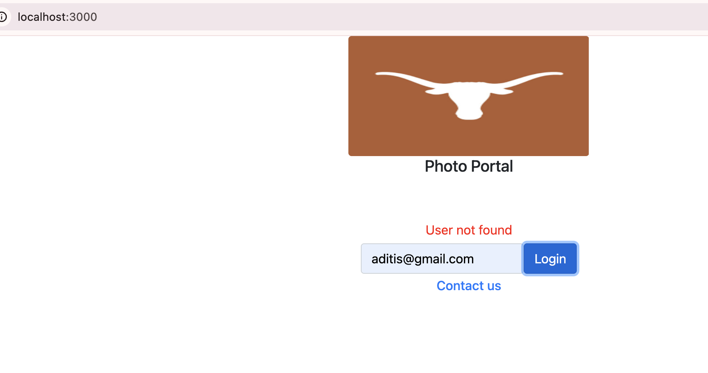
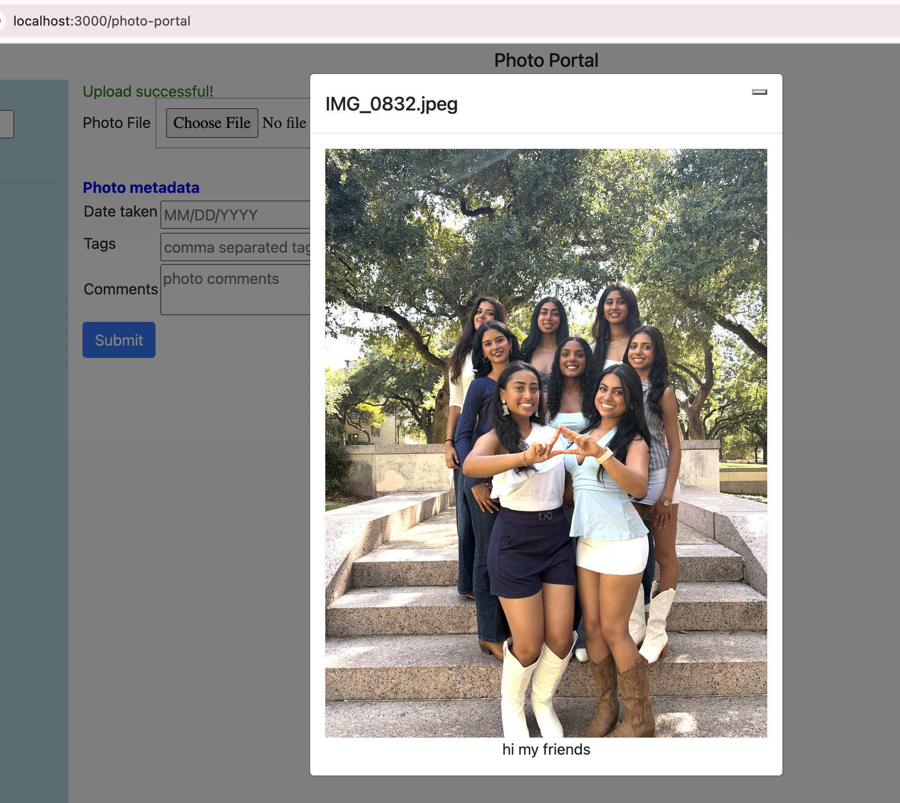

# Photo Portal Write-up

## Difficult requirement

The hardest part was getting the Flask API to run at all. The starter requirements.txt pinned Flask 2.0.1, but my virtual environment used Python 3.14, so flask crashed with an AttributeError. Python 3.14 removed that function, and old Flask versions still call it. I fixed it by unpinning Flask, Jinja2, Werkzeug and requests and upgrading to Flask 3.1 or newer. I then confirmed the app imported cleanly. A second, smaller problem was that port 5000 was already used by macOS AirPlay Receiver. For the admin login (1.4), I also chose to store passwords hashed with Werkzeug instead of as plain text, and to verify them with check_password_hash.

## Data flow: uploading a photo and viewing its comments

When an admin submits the upload form in  PhotoPortal.js, handleUpload sends the file, date, tags and comments as FormData to POST /api/upload. Flask's upload_photo() saves the image and stores the metadata in the Photo table through SQLAlchemy. React then calls GET /api/photos, which queries that table, and re-renders the thumbnails. Clicking a thumbnail calls GET /api/photos/<name>/comments, and the returned comments appear in the modal.

## Testing

I tested the API endpoints with Flask's test client, checking that user registration, login (including unknown users and wrong passwords), upload, and search by name, date and tags all returned the expected results. I then used the React app in the browser to confirm the "User not found" message, the comments textarea and modal, and search.

## Screenshots

Requirement 4.3; The general user login page shows "User not found" for an unregistered gmail address.

Requirement 3.6; Clicking a thumbnail opens the modal with the photo and its comments retrieved from the backend.
